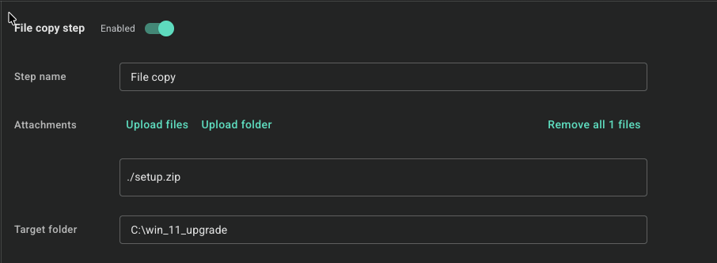
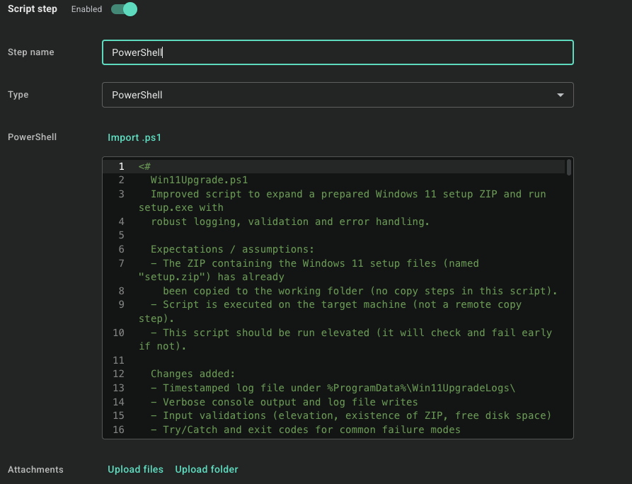

# Using the Windows 11 Upgrade scripts in PDQ Connect

This guide walks through building two PDQ Connect packages: one that upgrades a device to Windows 11 (`Win11Upgrade.ps1`) and one that cleans up afterwards (`Win11Cleanup.ps1`).

## Before you start

- Devices must meet Windows 11 requirements (TPM 2.0, Secure Boot, supported CPU). The upgrade script checks the TPM (present, ready, version 2.0) and Secure Boot (enabled) before launching setup and stops with an error if either fails. It does not check the CPU, and setup runs with `/compat ignorewarning`, so verify CPU eligibility yourself. To bypass the TPM and Secure Boot checks, change the default in the script's `param` block to `[switch]$SkipHardwareChecks = $true`.
- Each device needs at least 20 GB free on `C:`. The script fails early if it doesn't have that.
- The ZIP is several GB. Test on one device before deploying widely.

## Part 1: Prepare the setup ZIP

1. Download the latest Windows 11 ISO from Microsoft.
2. Extract the full contents of the ISO (setup files and everything that comes with it) to a folder.
3. Zip the contents directly. Do **not** zip the folder they are in. Open the extracted folder, select all the files and folders inside it, and zip those, so that `setup.exe` sits at the top level of the ZIP.
4. Name the ZIP `setup.zip`. If you use this name, you won't need to edit the script.

## Part 2: Create the upgrade package

Create a new package in PDQ Connect with two steps.

### Step 1: File copy

| Setting | Value |
| --- | --- |
| Step name | File copy |
| Attachments | `setup.zip` (use **Upload files**) |
| Target folder | `C:\win_11_upgrade` |

This copies the ZIP to `C:\win_11_upgrade\` on the target device. That is the script's default working folder, so no edits are needed.

### Step 2: Script step

| Setting | Value |
| --- | --- |
| Step name | PowerShell |
| Type | PowerShell |
| Script | Contents of `Win11Upgrade.ps1` (use **Import .ps1**) |

The script then:

1. Checks it is running elevated.
2. Exits successfully without doing anything if the device is already on Windows 11 (build 22000 or newer), so it is safe to target a mixed fleet. Add `$Force = $true` as the default in the `param` block to run anyway.
3. Checks the TPM (present and version 2.0) and Secure Boot (enabled), and stops if either fails, before doing any other work. A TPM that is present but not reported as ready only logs a warning.
4. Checks that `setup.zip` exists in the working folder, that there is at least 20 GB free, and that `setup.exe` is at the top level of the ZIP (a ZIP made from the folder instead of its contents fails here).
5. Expands the ZIP into the working folder.
6. Runs `setup.exe` silently with these flags: `/auto Upgrade /migratedrivers all /EULA accept /ShowOOBE none /dynamicupdate disable /quiet /compat ignorewarning /copylogs C:\Temp\Logs\WinSetup`.

**Reboot behavior:** the setup flags do not include `/noreboot`, so the device reboots on its own when setup is ready to continue. This is deliberate, because the reboot is a useful signal that the device is being upgraded. If you would rather control the timing, add `/noreboot` to the `$arguments` line in the script and schedule the reboot yourself.

If your custom ZIP or working folder name differs, pass the parameters or edit the defaults at the top of the script: `-ZipName` and `-WorkDir`.

## Part 3: Deploy and monitor

1. Deploy the package to a small pilot group first. Setting `[switch]$DryRun = $true` in the script's `param` block validates everything (hardware checks, ZIP present and valid, free space) and logs what it would do, without expanding the ZIP or running setup.
2. The upgrade takes a while and the device reboots one or more times. A successful run only means setup started (`setup.exe completed successfully` in the log); the upgrade finishes after the reboot, so confirm on the device rather than relying on step status alone.
3. Check the logs on the device:
   - `C:\temp\winupgradelogs\Win11Upgrade_<timestamp>.log`: the script log, including the `setup.exe` exit code
   - `C:\Temp\Logs\WinSetup`: the setup logs copied by `/copylogs`
4. Confirm the device is on Windows 11 (for example, build 22000 or newer in the device's OS details).

## Part 4: Create the cleanup package

Run this **after** the devices have finished upgrading and have rebooted into Windows 11. Do not add it as a third step in the upgrade package: setup finishes its work after the script returns, so cleanup would run too early. The cleanup script checks for Windows 11 and refuses to run on a device that has not upgraded yet, which protects against this, but a separate package is cleaner.

Create a new package with one step:

| Setting | Value |
| --- | --- |
| Step name | PowerShell |
| Type | PowerShell |
| Script | Contents of `Win11Cleanup.ps1` (use **Import .ps1**) |

By default this removes `C:\win_11_upgrade\` (the ZIP and expanded setup files) and the leftover `$WINDOWS.~BT`, `$WINDOWS.~WS` and `$GetCurrent` folders.

Optional switches (PDQ Connect runs the pasted script as-is, so enable these by changing the default in the script's `param` block, for example `[switch]$RemoveWindowsOld = $true`):

- `-RemoveWindowsOld`: also delete `C:\Windows.old`. This frees the most space but removes the ability to roll back to the previous Windows version. Windows deletes it automatically after about 10 days anyway.
- `-RemoveSetupLogs`: also delete `C:\Temp\Logs\WinSetup`. Leave this off until you are sure you no longer need the setup logs.
- `-DryRun`: log what would be removed without deleting anything.

The cleanup script refuses to delete a drive root, `C:\Windows`, Program Files, or other core system folders, so a mistyped `-WorkDir` cannot wipe the system.

Cleanup results are logged to `C:\temp\winupgradelogs\Win11Cleanup_<timestamp>.log`. Exit code `0` is success, `1` is an error or not on Windows 11, and `2` means some items could not be removed.

## Troubleshooting

- **`Expected zip file not found`**: the file copy step did not run or the ZIP name or folder does not match the script's `-ZipName` and `-WorkDir`.
- **`setup.exe is not at the top level` / `setup.exe not found`**: the ZIP was made from the containing folder rather than its contents. Re-zip the files directly.
- **`Unable to read ... as a ZIP archive`**: the ZIP is corrupt or incomplete (for example the file copy was interrupted). Re-upload it.
- **`Hardware check failed` / `HardwareRequirementsNotMet`**: the device has no ready TPM 2.0 or Secure Boot is off. Check the log for which one, fix it in firmware settings, or bypass with `$SkipHardwareChecks = $true` if you know the device is fine.
- **`Insufficient free space`**: free up at least 20 GB on `C:`.
- **Cleanup says the machine is not on Windows 11**: the upgrade has not completed or failed. Check the setup logs in `C:\Temp\Logs\WinSetup` and `C:\Windows\Panther`.
